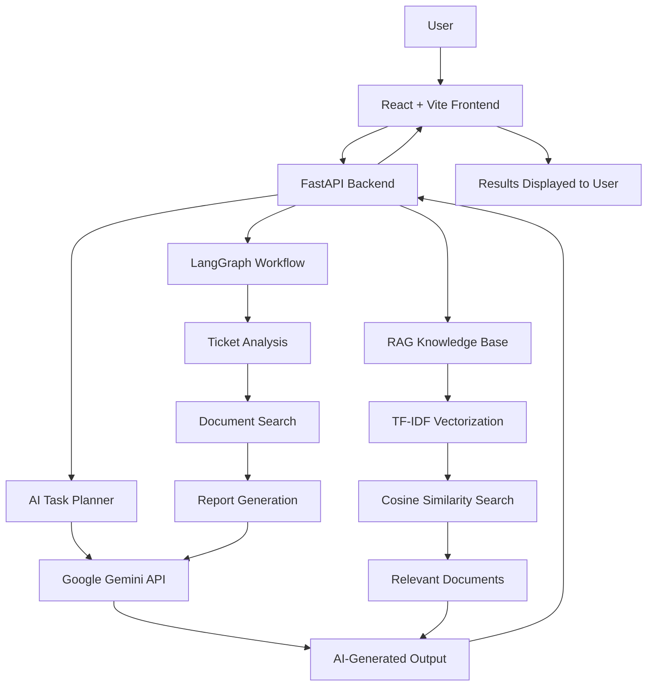

# AgentFlow AI — Agentic AI Workflow Automation Platform

An AI-powered workflow automation platform that combines **LLM-based task planning, Retrieval-Augmented Generation (RAG), and multi-step agent workflows** to analyze support tickets, retrieve relevant knowledge-base documents, and generate structured reports.

**Live Demo:** [AgentFlow AI](https://agentflow-ai-theta.vercel.app/)

**Backend API:** [FastAPI Backend](https://agentflow-ai-backend-90p6.onrender.com/)

**API Documentation:** [Swagger UI](https://agentflow-ai-backend-90p6.onrender.com/docs)

---

## Overview

AgentFlow AI demonstrates how agentic AI can coordinate multiple tasks instead of responding to a prompt with a single answer.

A user can describe a task or submit a support-related question. The application can generate an execution plan, retrieve relevant troubleshooting information from a knowledge base, and run a multi-step workflow that produces a structured report.

The platform uses Google Gemini for AI-powered reasoning and generation, LangGraph to coordinate workflow steps, and a lightweight TF-IDF retrieval system for knowledge-base search.

## Key Features

- **AI Task Planning:** Generates a structured plan for a user-provided task using an LLM.
- **Knowledge-Base Search:** Retrieves relevant support documentation using TF-IDF vectorization and cosine similarity.
- **RAG-Based Answers:** Uses retrieved knowledge-base content to generate evidence-grounded responses.
- **Agentic Workflow Execution:** Coordinates ticket analysis, document retrieval, and report generation.
- **Ticket Analysis:** Processes sample support tickets and identifies high-priority issues.
- **Automated Report Generation:** Combines workflow results into a structured report.
- **REST API:** Exposes backend functionality through FastAPI endpoints.
- **Web Interface:** Provides a React-based interface for interacting with the AI system.
- **Cloud Deployment:** Frontend hosted on Vercel and backend hosted on Render.

## Architecture



## How the Workflow Works

AgentFlow AI supports individual AI operations as well as a complete multi-step workflow.

### 1. User submits a task

The user enters a request in the web interface, such as:

> Customers are unable to complete payments after checkout. Analyze the issue, find troubleshooting steps, and generate a report.

The React frontend sends the task to the FastAPI backend.

### 2. AI task planning

The backend uses Google Gemini to transform the user's request into an organized plan.

A plan can identify steps such as:

1. Analyze the support-ticket data.
2. Search the knowledge base for relevant documentation.
3. Generate a report containing the findings.

The plan is returned to the frontend for display.

### 3. Knowledge-base retrieval

The retrieval component searches the project's knowledge-base documents.

The retrieval pipeline works as follows:

1. Load the available knowledge-base documents.
2. Split document text into overlapping chunks.
3. Convert the chunks into TF-IDF feature vectors.
4. Convert the user's question into a compatible vector.
5. Calculate cosine similarity between the query and document chunks.
6. Rank the results and return the most relevant content.

This implementation uses scikit-learn rather than a large sentence-transformer model, reducing dependency and memory requirements for deployment.

### 4. RAG-based answer generation

Retrieval-Augmented Generation combines relevant retrieved information with an LLM-generated response.

The backend retrieves relevant troubleshooting content and passes it to the answer-generation component. Google Gemini then generates an answer grounded in the retrieved information.

This approach helps the system provide context-specific support guidance instead of relying entirely on the model's general knowledge.

### 5. Multi-step workflow execution

When the user selects **Execute Workflow**, the backend coordinates the workflow through LangGraph.

The workflow contains these logical stages:

**Stage A — Ticket Analysis**

Analyzes the available sample support tickets and identifies issue patterns and priority levels.

**Stage B — Document Search**

Retrieves relevant knowledge-base content to support troubleshooting and analysis.

**Stage C — Report Generation**

Combines the analysis and retrieved information to generate a structured report.

The workflow returns its results to the frontend, where the user can review the generated output.

### 6. Results and report display

The frontend displays the results returned by the backend, including applicable task plans, knowledge-base answers, ticket-analysis results, and generated reports.

The exact output depends on the selected operation and the data available to the workflow.

## Technology Stack

| Component | Technology |
|---|---|
| Frontend | React.js, Vite |
| Backend | Python, FastAPI |
| LLM | Google Gemini API |
| Agent workflow orchestration | LangGraph |
| Retrieval and ranking | scikit-learn TF-IDF, cosine similarity |
| Numerical operations | NumPy |
| Configuration | Python dotenv |
| Frontend hosting | Vercel |
| Backend hosting | Render |
| API testing | FastAPI Swagger UI |

## Project Structure

```text
Agentic AI Automation Platform/
├── backend/
│   ├── main.py
│   ├── requirements.txt
│   ├── tools/
│   │   ├── document_search.py
│   │   └── rag_answer.py
│   └── ...
├── frontend/
│   ├── src/
│   │   └── App.jsx
│   ├── package.json
│   └── ...
├── .gitignore
└── README.md
```

*Note: This is a high-level structure. Keep the filenames and directories aligned with the actual repository.*

## API Endpoints

The FastAPI backend exposes the following endpoints:

| Method | Endpoint | Purpose |
|---|---|---|
| GET | `/health` | Checks backend health and Gemini configuration status |
| POST | `/api/plan` | Generates an AI task plan |
| POST | `/api/answer` | Generates a knowledge-grounded answer |
| POST | `/api/execute` | Executes the multi-step workflow |

Interactive API documentation is available at:

[Open Swagger UI](https://agentflow-ai-backend-90p6.onrender.com/docs)

### Example: Health Check

**Request**

```http
GET /health
```

**Example response**

```json
{
  "status": "healthy",
  "application": "AgentFlow AI",
  "gemini_configured": true
}
```

The response indicates backend health and whether the Gemini API configuration is present. It does not by itself guarantee that every AI operation will succeed.

## Run Locally

### Prerequisites

- Python installed
- Node.js and npm installed
- A Google Gemini API key
- Git

### 1. Clone the repository

```bash
git clone YOUR_GITHUB_REPOSITORY_URL
cd "Agentic AI Automation Platform"
```

Replace `YOUR_GITHUB_REPOSITORY_URL` with your actual repository URL.

### 2. Configure the backend

```bash
cd backend
python -m venv .venv
```

Activate the virtual environment.

**Windows PowerShell:**

```powershell
.\.venv\Scripts\Activate.ps1
```

Install the backend dependencies:

```bash
python -m pip install -r requirements.txt
```

Create a `.env` file in the backend directory:

```env
GEMINI_API_KEY=your_gemini_api_key
GEMINI_MODEL=gemini-2.5-flash
```

Replace the placeholder with your own API key. Never commit the `.env` file to GitHub.

Start the backend:

```bash
uvicorn main:app --reload
```

The local backend will normally be available at:

`http://127.0.0.1:8000`

Open `http://127.0.0.1:8000/docs` to test the API.

### 3. Configure the frontend

Open a second terminal and navigate to the frontend directory:

```bash
cd frontend
npm install
```

Create a `.env` file in the frontend directory:

```env
VITE_API_BASE_URL=http://127.0.0.1:8000
```

This value is for local development. For the deployed frontend, configure the public Render backend URL in Vercel.

**Important:** `VITE_` variables are exposed to browser code. Store only public configuration values in them, never API keys or other secrets.

### 4. Start the frontend

```bash
npm run dev
```

Open the local URL displayed by Vite in your terminal.

## Deployment

### Frontend — Vercel

Live application: [https://agentflow-ai-theta.vercel.app/](https://agentflow-ai-theta.vercel.app/)

Configure the following environment variable in the Vercel project settings:

```env
VITE_API_BASE_URL=https://agentflow-ai-backend-90p6.onrender.com
```

Ensure the frontend source code reads this variable instead of hardcoding a local backend URL. Redeploy after changing the environment variable or source code.

### Backend — Render

Backend: [https://agentflow-ai-backend-90p6.onrender.com/](https://agentflow-ai-backend-90p6.onrender.com/)

Configure these backend environment variables in Render:

```env
GEMINI_API_KEY=your_gemini_api_key
GEMINI_MODEL=gemini-2.5-flash
```

Keep the API key in the backend environment only. Do not put it in the frontend or commit it to source control.

## Testing

Use the live Swagger UI or the frontend to test the following:

- Backend health check
- AI task-plan generation
- Knowledge-base question answering
- End-to-end workflow execution
- Correct handling of invalid requests and backend failures

A successful health check confirms that the backend responds, but each AI endpoint should be tested separately.

## Design Considerations

### Lightweight retrieval

The project uses TF-IDF and cosine similarity for retrieval. This design avoids loading a large embedding model and reduces deployment resource requirements.

TF-IDF is a lexical retrieval method, so it may miss relevant documents when a question uses different wording from the source material. More advanced embedding-based retrieval could be added in a future version.

### LLM-powered reasoning

Google Gemini handles task planning and language generation. The backend coordinates these operations and supplies relevant retrieved context when generating RAG-based answers.

### Workflow orchestration

LangGraph organizes the workflow into separate stages, making the process easier to extend, test, and maintain.

## Limitations

- The quality of AI output depends on the LLM response and the available context.
- TF-IDF retrieval depends on lexical overlap and may not capture every semantic relationship.
- The demonstration workflow uses the support-ticket and knowledge-base data provided by the project.
- Generated analysis and reports should be reviewed before being used for real operational decisions.
- Live service availability may depend on the hosting provider and its resource limits.

## Future Improvements

- Add more knowledge-base documents and support-ticket datasets.
- Introduce semantic or hybrid search.
- Add workflow tracing and execution logs.
- Implement retry handling and clearer error reporting.
- Add automated tests for individual endpoints and complete workflows.
- Support user-defined workflow steps and additional tools.
- Add authentication and access controls before production use.

## Security

- Never commit `.env` files, API keys, or credentials.
- Keep `GEMINI_API_KEY` exclusively in the backend environment.
- Expose only non-sensitive frontend configuration through `VITE_` variables.
- Configure CORS to allow only the intended frontend origins in production.
- Validate inputs and review generated outputs before taking consequential actions.

## Author

**Kothinti Tharun**

Computer Science and Engineering Graduate | Full-Stack Developer | AI/ML Enthusiast

- **GitHub:** [KothintiTharun035](https://github.com/KothintiTharun035)
- **Portfolio:** [tharun-portfolio-nine.vercel.app](https://tharun-portfolio-nine.vercel.app/)
- **Live Project:** [AgentFlow AI](https://agentflow-ai-theta.vercel.app/)

---

*AgentFlow AI is a portfolio project demonstrating agentic workflow orchestration, LLM-based task planning, retrieval-augmented generation, and automated report generation.*
    